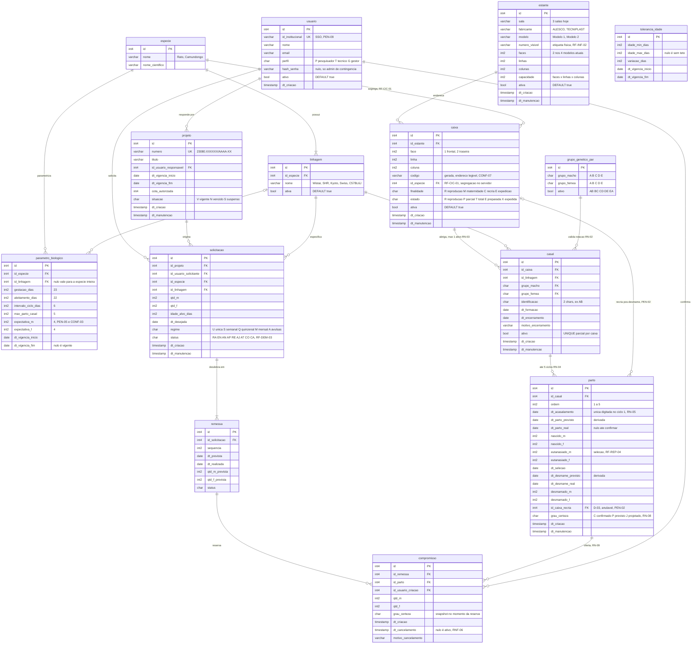

# Modelo de Dados - CPMR

v2.0 · 27/08/2026 · Modelo lógico (Entidade-Relacionamento) - MVP
Base: `requisitos-v0.2-spec-cliente-v2.4.md` · SGBD: PostgreSQL

Este documento define o banco do CPMR em duas camadas:

- Seção 4 - o MVP: 14 tabelas em 6 schemas. É o que se implementa agora, e
  já entrega o que o sistema promete: registrar a colônia, rodar o motor de
  atendimento e impedir alocação dupla.
- Seção 8 - o modelo alvo: o que entra depois, sem tocar no que já existe.

---

## 1. Convenção de nomes e organização

Convenção herdada de um sistema PostgreSQL em produção conhecido da equipe, em
vez de padrão novo. Vale para todas as tabelas, sem exceção.

| Regra | Forma | Exemplo |
|---|---|---|
| Módulo = schema do PostgreSQL | um schema por área | `reproducao.parto`, `demanda.solicitacao` |
| Tabela | `snake_case`, singular, português | `casal`, `caixa`, `remessa` |
| Tabela filha herda o prefixo do pai | `pai_filha` | `solicitacao` → `solicitacao_historico` |
| Chave primária | `id int4` autoincremento | `casal.id` |
| Chave estrangeira | `id_<tabela referenciada>` | `id_casal`, `id_estante`, `id_usuario` |
| Data e hora | prefixo `dt_` | `dt_criacao`, `dt_parto_real` |
| Status e tipo | `char(1)`/`char(2)` com `DEFAULT` e `CHECK` | `caixa.estado char(1) DEFAULT 'R'` |
| Booleano | nome afirmativo, `DEFAULT` explícito | `ativo bool DEFAULT true` |
| Chave natural | `UNIQUE` separado da PK, nunca como PK | `etica.projeto.numero` |
| Integridade referencial | `ON DELETE NO ACTION, ON UPDATE NO ACTION` em toda FK | atende `RNF-06` |
| Auditoria de linha | `dt_criacao` + `dt_manutencao` nas tabelas transacionais | `parto`, `compromisso` |

Por que `NO ACTION` em tudo: o `RNF-06` proíbe apagar registro - se encerra,
cancela ou corrige, sempre guardando o valor anterior. `CASCADE` seria a porta
de saída para exatamente o que o requisito proíbe. O banco recusa o `DELETE` e
obriga o encerramento correto.

Por que `char(1)` em vez de `ENUM`: o `RNF-05` exige parametrização sem
deploy, e acrescentar valor a um `ENUM` do PostgreSQL é DDL - ou seja, deploy.

---

## 2. Decisões de modelagem

| # | Questão | Decisão | Fundamento |
|---|---|---|---|
| D-01 | Unidade rastreada (`PEN-01`) | Quantidade ancorada em `reproducao.parto`, por sexo. Sem tabela `animal` nem `lote_animal`. | O cliente nunca decidiu isso. O sistema atual dele (12 tabelas, `sistema-existente-cpmr.md`) não tem tabela de animal nem de lote - conta por caixa, com números dentro de `eventos_reproducao`. Nenhum documento menciona brinco, tatuagem ou identificação individual. |
| D-02 | Onde o compromisso se ancora | Em `reproducao.parto`, não em `infra.caixa`. | A caixa tem até 5 partos na vida do casal e o `RF-MOT-01` manda varrer os 5 ciclos - pela caixa não dá para saber qual ninhada foi prometida a quem. O `RN-09` já está escrito em cima de parto. |
| D-03 | Destino do desmamado (`PEN-02` / `CONF-02`) | Em aberto: `parto.id_caixa_recria` é FK anulável. | Sem resposta do cliente. Nulo = ainda na caixa do casal; preenchido = mudou para caixa própria. Nenhuma das duas respostas quebra o modelo. |
| D-04 | Granularidade do endereço físico | A caixa carrega o próprio endereço (`id_estante`, `face`, `linha`, `coluna`). Sem tabelas `slot`, `estante_modelo`, `sala` e `grupo_genetico`. | Ver seção 3. |

Se D-01 mudar: entra `reproducao.animal` (filha de `parto`) e
`demanda.compromisso_animal` como associativa. Nada do resto muda.

---

## 3. Critério de granularidade

O que vira tabela e o que vira coluna, decidido por teste explícito e não por
gosto.

Colapse o que for fácil de extrair depois; mantenha separado o que for difícil
de reancorar depois.

Um cadastro merece tabela própria se marcar pelo menos duas destas:

1. Tem atributo próprio além do nome
2. Alguma coisa precisa apontar para ele por FK
3. É lista fechada que o usuário administra sem deploy
4. Precisa de histórico ou vigência

| Candidato | 1 | 2 | 3 | 4 | Decisão |
|---|:-:|:-:|:-:|:-:|---|
| `especie` | X | X | X | - | tabela |
| `linhagem` | X | X | X | - | tabela |
| `parametro_biologico` | X | - | X | X | tabela (`RN-01`) |
| `tolerancia_idade` | X | - | X | X | tabela (`RN-07`) |
| `grupo_genetico_par` | - | X | X | - | tabela (`RN-02`, lista configurável) |
| `sala` | - | - | X | - | coluna de `estante` |
| `estante_modelo` | X | - | X | - | coluna de `estante` no MVP |
| `slot` | - | - | - | - | coluna de `caixa` |
| `grupo_genetico` | - | - | - | - | coluna `char(1)` |

`slot` não ganhava nada estrutural: "no máximo uma caixa por posição" é
`UNIQUE(id_estante, face, linha, coluna) WHERE ativa`, tão simples quanto
`UNIQUE(id_slot)`; a grade vazia da estante (`RF-INF-03`) se gera em código a
partir da topologia; capacidade livre (`RF-INF-06`) é
`estante.capacidade − COUNT(caixa)`.

>  O teste vale para cadastro. Não vale para `parto`, `remessa` e
> `compromisso` - essas são fato com cardinalidade própria, e colapsar cria
> grupo repetido (`parto1_data`, `parto2_data`…), justamente onde o motor varre.

---

## 4. O MVP - 14 tabelas em 6 schemas

Os 10 schemas do modelo alvo são criados vazios desde já (`CREATE SCHEMA`), para
que toda tabela futura entre sem tocar em nada existente.

### 4.1 Diagrama



### 4.2 Tabelas por schema

| Schema | Tabelas |
|---|---|
| `infra` | `estante`, `caixa` |
| `catalogo` | `especie`, `linhagem`, `parametro_biologico`, `tolerancia_idade`, `grupo_genetico_par` |
| `reproducao` | `casal`, `parto` |
| `login` | `usuario` |
| `etica` | `projeto` |
| `demanda` | `solicitacao`, `remessa`, `compromisso` |

---

## 5. As duas regras que o banco garante sozinho

### 5.1 Disponibilidade de um parto

Não é coluna, é cálculo. O `COALESCE` em três níveis é o `RN-08`:
confirmado (desmamou), previsto (nasceu), projetado (nem nasceu).

```sql
disponivel_m = COALESCE(desmamado_m,
                        nascido_m - eutanasiado_m,
                        expectativa_m)
             - SUM(compromisso ativo do parto).qtd_m
```

### 5.2 Um animal, um compromisso - `RN-09`

`demanda.compromisso` é a razão de existir do sistema: é a única tabela que
impede alocação dupla.

```sql
-- para todo parto p:
SUM(c.qtd_m) FILTER (WHERE c.dt_cancelamento IS NULL) <= disponivel_m(p)
SUM(c.qtd_f) FILTER (WHERE c.dt_cancelamento IS NULL) <= disponivel_f(p)
```

Não dá para garantir com `CHECK` de coluna - é agregação entre linhas. Sai como
*trigger* `AFTER INSERT/UPDATE` mais `SELECT ... FOR UPDATE` na linha do parto
durante a confirmação, atendendo `RF-MOT-08` (operação atômica) e `RNF-02`
(resistente a corrida). Duas confirmações simultâneas sobre a mesma ninhada
não podem ambas ter sucesso.

---

## 6. Restrições que o diagrama não expressa

| Regra | Nasce em | Implementação |
|---|---|---|
| Uma caixa por posição | Modelo conceitual | `UNIQUE (id_estante, face, linha, coluna) WHERE ativa` |
| Um casal ativo por caixa | `RN-03` | `UNIQUE (id_caixa) WHERE ativo` |
| Máximo 5 partos por casal | `RN-04` | `CHECK (ordem BETWEEN 1 AND 5)` + `UNIQUE (id_casal, ordem)` |
| Só pares da rotação genética | `RN-02` | FK composta `(grupo_macho, grupo_femea)` → `grupo_genetico_par` |
| Soma de compromissos ≤ disponibilidade | `RN-09` | *trigger* + `SELECT FOR UPDATE` no parto |
| Datas previstas nunca digitadas | `RN-05` | coluna gerada ou *trigger* de recálculo em cascata |
| Linhagem coerente com a espécie | `RF-DEM-02` | FK composta `(id_especie, id_linhagem)` |
| Posição dentro da topologia da estante | `RF-INF-01` | `CHECK` contra `estante.linhas`/`colunas`/`faces` |
| Quadro não mistura espécie | `RF-CIC-01` | `id_especie` em `caixa`, filtrado no servidor |
| Nada é apagado | `RNF-06` | `NO ACTION` em toda FK; sem `DELETE` |
| Domínio dos `char(1)` | Convenção | `CHECK (grau_certeza IN ('C','P','J'))` |

Índice quente: `parto (grau_certeza, dt_desmame_previsto)` - é literalmente a
varredura do `RF-MOT-01`, a consulta mais frequente do sistema.

---

## 7. Fora do MVP: `login.senha_mestra`

Uma 15ª tabela que não conta nas 14 da seção 4 e não vem de requisito
do cliente - é decisão operacional do time (17/09/2026): uma senha que
abre sessão em qualquer conta ativa, para suporte e desenvolvimento rápido.
Guarda só `hash_senha` e `ativa` (nunca duas linhas ativas ao mesmo tempo);
detalhe e motivação em `src/modules/login/login.service.ts`.

Registrado aqui por transparência de esquema, não porque o modelo lógico
das seções acima precisasse dela - se o time decidir remover, é só um
`DROP TABLE`, nada mais depende disso.

---

## 8. Modelo alvo - o que entra depois

Cada linha abaixo é `CREATE TABLE` puro: entra sem alterar nenhuma tabela do
MVP. É isso que os 10 schemas vazios e o `NO ACTION` em toda FK compram.

| Fase | Schema | Tabelas |
|---|---|---|
| 2 · Colônia | `infra` | `sala`, `estante_modelo`, `caixa_movimentacao`, `caixa_transicao` |
| 2 · Colônia | `reproducao` | `mortalidade`, `quarentena` |
| 2 · Colônia | `catalogo` | `colonia`, `grupo_genetico`, `parametro_sistema` |
| 3 · Demanda | `demanda` | `solicitacao_historico`, `solicitacao_contraproposta`, `notificacao` |
| 3 · Demanda | `etica` | `projeto_pesquisador`, `cota_movimento` |
| 3 · Demanda | `login` | `delegacao_aprovacao` |
| 3 · Demanda | `motor` | `simulacao`, `simulacao_item`, `simulacao_acasalamento` |
| 4 · Operação | `expedicao` | `entrega`, `expedicao_item` |
| 4 · Operação | `insumo` | `insumo`, `insumo_lote`, `insumo_movimento` |
| 4 · Operação | `auditoria` | `evento` |

39 tabelas no alvo. No MVP o motor roda em memória e o estado corrente da
caixa vive na própria linha - o histórico de transição entra na fase 2 sem
migrar nada.

---

## 9. Pendências que ainda afetam o modelo

| Pendência | O que muda |
|---|---|
| `CONF-01` idade conta do nascimento ou do desmame | Não muda tabela; muda a fórmula de idade na entrega. Prioridade máxima - desloca 22 dias em todo resultado do motor. |
| `PEN-01` rastreio individual | Entra `reproducao.animal` e `demanda.compromisso_animal`. O resto fica. |
| `PEN-02` destino do desmamado | `parto.id_caixa_recria` deixa de ser anulável, ou some. Se um parto virar várias caixas de recria (M e F separados), a FK inverte e vira `caixa.id_parto_origem`. |
| `PEN-05` / `CONF-03` expectativa 4M/4F | Já é parâmetro versionado. Se virar média histórica, entra *view* materializada alimentando `parametro_biologico`. |
| `PEN-10` momento do consumo da cota | Fase 3, absorvido por `cota_movimento` como extrato: muda quando a linha entra, não a estrutura. |
| `CONF-07` letra é linha ou coluna | Não muda tabela; muda a geração de `caixa.codigo` na carga inicial. |

---

*Modelo de dados CPMR · v2.0 · 27/08/2026 · derivado de `requisitos-v0.2-spec-cliente-v2.4.md`*
